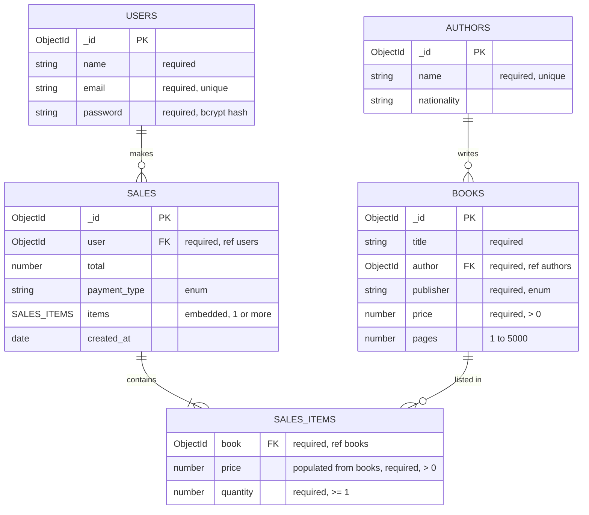

# express-mongo-api

Bookstore REST API built with Node.js, Express and MongoDB (Mongoose), providing CRUD for authors, books and users.

The code is organized in layers: routes receive the request, controllers handle HTTP, services hold the business rules and Mongoose models talk to the database. As a REST API, the "view" is the JSON response.

## Modeling


### Data models

| Resource | Fields                                                                                              |
| -------- | --------------------------------------------------------------------------------------------------- |
| Author   | `name` (required, unique), `nationality`                                                            |
| Book     | `title`, `author` (author ID), `publisher`, `price` (greater than 0), `pages` (1 to 5000, optional) |
| Publisher     | ENUMs `HarperCollins`, `DC Comics` and `Marvel Comics` |
| User     | `name`, `email` (valid format, unique), `password`                                                  |
| Sale     | `user` (user ID), `items` (`book`, `price`, `quantity`), `total`, `payment_type`, `created_at`              |


## API

### Authors

| Method | Route          | Description      |
| ------ | -------------- | ---------------- |
| GET    | `/authors`     | List authors     |
| GET    | `/authors/:id` | Get author by ID |
| POST   | `/authors`     | Create author    |
| PUT    | `/authors/:id` | Update author    |
| DELETE | `/authors/:id` | Delete author    |

### Books

| Method | Route          | Description              |
| ------ | -------------- | ------------------------ |
| GET    | `/books`       | List books               |
| GET    | `/books/query` | Search books (see below) |
| GET    | `/books/:id`   | Get book by ID           |
| POST   | `/books`       | Create book              |
| PUT    | `/books/:id`   | Update book              |
| DELETE | `/books/:id`   | Delete book              |

#### Searching books

`GET /books/query` accepts these filters, which can be combined (a book must match all of them)

```
GET /books/query?authorName=stan&minPrice=50&maxPrice=120
```

| Parameter    | Description                                                      |
| ------------ | ---------------------------------------------------------------- |
| `title`      | Partial, case-insensitive match on the title                     |
| `publisher`  | Partial, case-insensitive match on the publisher                 |
| `authorName` | Partial, case-insensitive match on the author name (first match) |
| `minPrice`   | Minimum price (inclusive)                                        |
| `maxPrice`   | Maximum price (inclusive)                                        |

Requests that match nothing return `200` with an empty list.

### Users

| Method | Route        | Description    |
| ------ | ------------ | -------------- |
| GET    | `/users`     | List users     |
| GET    | `/users/:id` | Get user by ID |
| POST   | `/users`     | Create user    |
| PUT    | `/users/:id` | Update user    |
| DELETE | `/users/:id` | Delete user    |

Passwords are hashed with bcrypt before being saved (also when updated) and are never returned by the API. Creating a user with an e-mail that is already registered returns `400` with type `EMAIL_ALREADY_REGISTERED`.

### Pagination and sorting

The list routes (`GET /authors`, `GET /books`, `GET /books/query`, `GET /users`) accept these query parameters:

```
GET /books?page=2&limit=10&sortBy=price&order=desc
```

| Parameter | Default | Description                                   |
| --------- | ------- | --------------------------------------------- |
| `page`    | `1`     | Page number                                   |
| `limit`   | `5`     | Items per page (maximum `100`)                |
| `sortBy`  | `_id`   | Field to sort by. It must exist in the schema |
| `order`   | `asc`   | `asc` or `desc`                               |

Invalid `page` and `limit` values fall back to the defaults. An unknown `sortBy` or an `order` other than `asc`/`desc` returns `400`.

## Getting started

## Technologies

- Node.js (ES Modules)
- Express 5
- MongoDB + Mongoose
- bcrypt (password hashing)
- Nodemon
- Node.js test runner (`node:test`) + Supertest
- ESLint

### Prerequisites

- Node.js with `--env-file` support (v20.6 or newer)
- A running MongoDB instance (local or hosted)

## Project structure

```
server.js            # starts the HTTP server
src/
  app.js             # Express app: database connection, routes and error handlers
  config/            # database connection
  routes/            # endpoint definitions
  controllers/       # request/response handling
  services/          # business rules (duplicate checks, author lookup, ...)
  models/            # Mongoose schemas
  middlewares/       # pagination, not found and error handlers
    errors/          # error classes (BaseError, BadRequestError, ...)
  utils/             # pagination parsing
test/                # integration and end-to-end tests
  helpers/           # helpers shared by the e2e tests (create and clean up data)
```

### Installation

```bash
npm install
cp .env.example .env
```

Fill in `.env` (see [Environment variables](#environment-variables)) and start the server in development mode:

```bash
npm run dev
```

The API listens on `PORT` (default `3000`).

### Environment variables

| Variable               | Description                                 |
| ---------------------- | ------------------------------------------- |
| `PORT`                 | Port the server listens on (default `3000`) |
| `DB_CONNECTION_STRING` | MongoDB connection string                   |
| `DB_NAME`              | Database name used by the connection        |

`.env` and `.env.test` are ignored by git. Only `.env.example` is versioned.

### Errors

Every error response has the same shape:

```json
{
  "status": 400,
  "message": "Human readable description",
  "type": "BAD_REQUEST"
}
```

Clients should rely on `status` and `type`. The `message` is meant for people and may change.

| Type                         | Status | When                                          |
| ---------------------------- | ------ | --------------------------------------------- |
| `VALIDATION_ERROR`           | 400    | A field fails schema validation               |
| `BAD_REQUEST`                | 400    | Malformed ID, invalid pagination or sorting   |
| `AUTHOR_NAME_ALREADY_EXISTS` | 400    | Author name is already taken                  |
| `EMAIL_ALREADY_REGISTERED`   | 400    | User e-mail is already registered             |
| `UNEXISTING_AUTHOR`          | 400    | Book references an author that does not exist |
| `NOT_FOUND`                  | 404    | Resource or route not found                   |
| `INTERNAL_SERVER_ERROR`      | 500    | Unexpected error                              |

## Tests

The tests use the Node.js test runner and [Supertest](https://github.com/ladjs/supertest). There are no mocks: they run against a real MongoDB.

| Script             | What it runs                        |
| ------------------ | ----------------------------------- |
| `npm test`         | All tests                           |
| `npm run test:int` | Integration tests (`test/*.int.js`) |
| `npm run test:e2e` | End-to-end tests (`test/*.e2e.js`)  |

### Setup

The test scripts load their configuration from `.env.test`.

```bash
cp .env.example .env.test
```

> **Use a dedicated database for tests.** The tests create and delete records, so `DB_NAME` in `.env.test` must not point to the database you use for development or production.

### Test types

- **End-to-end** (`test/*.e2e.js`): call the HTTP routes through `app` with Supertest and check status codes, response bodies and error `type`. They also cover `GET /books/query` (title, author, publisher, price range and searches with no results). Bugs between the controller and the service, such as passing the wrong object, only show up at this level.
- **Integration** (`test/*.int.js`): call the services directly against the database to check business rules, such as duplicate author names, duplicate e-mails, books with an unexisting author and password hashing on update.

### Conventions

- Each test creates the data it needs, using the API itself or the helper in `test/helpers/createHelper.js`, and does not depend on other tests.
- Tests clean up after themselves (`DELETE` requests or `deleteMany` in the `after` hook).
- The Mongoose connection is shared by the whole test file. Call `mongoose.disconnect()` in a single file-level `after` (outside any `describe`) and keep only the data cleanup in each `describe`. Disconnecting inside a `describe` breaks the ones that run after it, and the failures look like `Cannot read properties of undefined` or `500` responses. They only show up when the whole file runs, not when you filter with `--test-name-pattern`.
- Error assertions check `status` and `type`, not the `message`, so reworded messages do not break the tests.
- Fixed names and e-mails are used per test. If a run is interrupted before cleanup, leftover records can make the next run fail with `400` (duplicate name or e-mail). Remove them from the test database and run again.

## Linting

```bash
npm run lint
```

ESLint 10 runs over every `.js`, `.mjs` and `.cjs` file in the project (`node_modules` is ignored by default). The configuration is in `eslint.config.js`: the `js/recommended` rule set plus these style rules, all reported as errors.

| Rule             | Requirement                                                           |
| ---------------- | --------------------------------------------------------------------- |
| `indent`         | 2 spaces                                                              |
| `quotes`         | Double quotes                                                         |
| `semi`           | Semicolon at the end of statements                                    |
| `linebreak-style`| Unix line endings (`\n`)                                              |
| `no-unused-vars` | No unused variables or imports. Unused function arguments are allowed |

The linter only reports problems. To fix the automatic ones (indentation, quotes, semicolons), run `npx eslint --fix`.

Run the linter before committing: the tests do not check code style.
